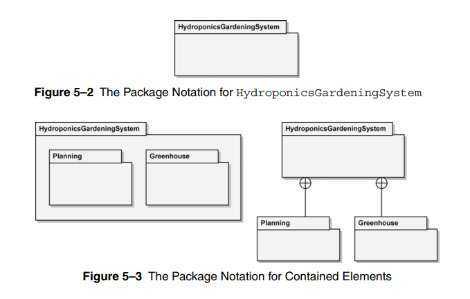
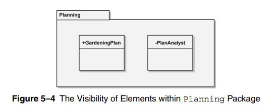
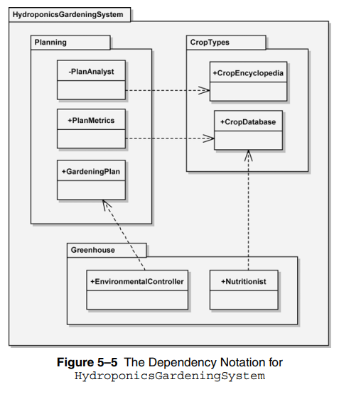
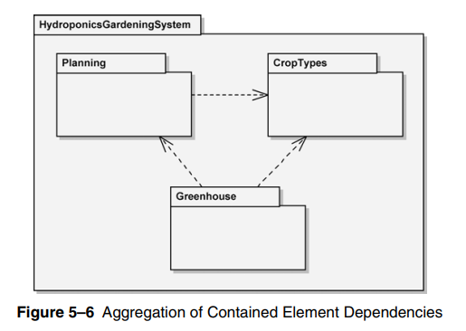
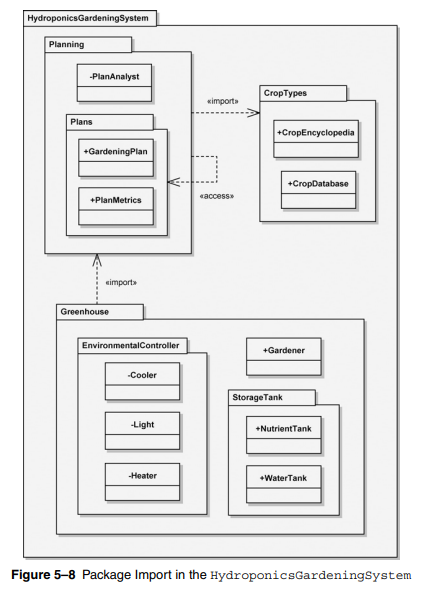

# Package Diagram

- used to organize the artifacts of the dev. process (problem analysis & design)

- package diagram has **2 primary notations**
  - **package**: rectangle with name tab at the top-left
  - **dependency relationship**: dashed arrow (open head) `--->`

- name tab is at the interior (above) the rectangle if package has no elements, otherwise

## Visibility

- visibility is either public (+), or private (-) placed at the front of the package name `+RoutingMetrics`, `-RoutingConfig`

- public is visible to
  - elements within it's containing package (including nested packages)
  - external elements of other packages (that has relationship with this package)

- public visibility could be thought of as the **package interface**

- private is visible to
  - elements within it's containing package (including nested packages)
  - nested packages within itself (children)

- packages with relations can't see the private members of each others

## Dependencies

- dependencies maybe labeled to highlight the dep. type

- if many dep. exists between different components of packages, the dep. maybe applied at the package level (labeled if all dep. are of the same type `PkgA ---<<import>>---> PkgB`)

> note that packages can contain other UML elements (classes, actors, ...)

- deciding how to package elements may depend on arch., sub-systems, users, ...etc

- packages should be **loosely coupled**, and **highly cohisive**
  - loosely coupled: each does one piece of work, effictively
  - highly cohisive: responsibilities of a single package are related

- interactions between package elements should be more than interactions with other packages

- each package provide a **namespace**, elements withing a namespace should have unique names (avoid collision), and could be referenced by the following format `packageName::elementName`

- the notation `StorageTank::WaterTank` is called the qualified name of `WaterTank`, while simple/unqualified name is just the element name without any path prefixes

- un-qualified names can be used to access:
  - owned elements
  - imported elements
  - elements of parent packages

- un-qualified names can't be used to mention elements of the same type with the same name (Lights.Cooler & Heat.Cooler)

- import vs. access relationships
  - import: _public_ package import
  - access: _private_ package import (within the same package)

- look at the following image, who can access what ? with qualified/simple names ?

- `Planning` Imports `CropTypes`
  - `Planning` planning can access all public members of `CropTypes`
  - access is made using un-qualified (simple names)

- `GreenHouse` Imports `Planning`
  - `GreenHouse` planning can access all public members of `Planning`
  - access is made using un-qualified (simple names)
  - private members of `Planning` -> `-PlanAnalyst` is invisible to `GreenHouse`

- `Planning` Accesses `Plans` sub-package
  - `Planning` can access all public members of `Plans`
  - access is made using the _qualified names_ `Plans::PlanMetrics`

- rules
  - import: access by simple names
  - access: access by un-qualified names
  - any private member is invisible anywhere (parent pkg / child pkg / external pkg)
  - parent pkg can't directly access child pkg contents without relationship
  - child pkg automatically access parent pkg public members using un-qualified names

---

### Readings

- cohision vs. coupling
