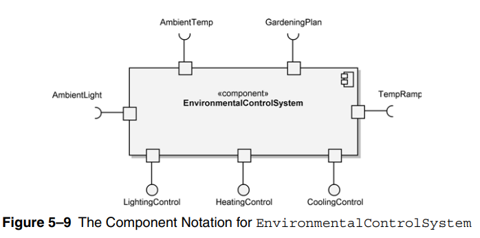
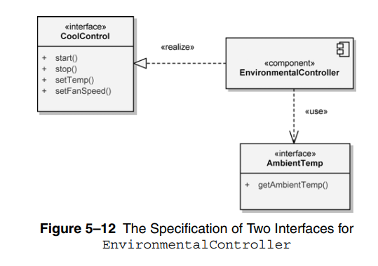

# Component Diagram

- used to indicate the logical layering and partitioning of our architecture

- component diagram **essential elements** are
  - **components**
  - **interfaces**
  - **realizations**

- component represeted by rectangle with the `<<component>>` label and component icon (top-right)

- ports could be named `portName:portType`

- ports could be inside the component

- provided interfaces represented by **ball-and-socket** notation

- required interfaces represented by **socket** notation

- if we need to show more details about a component’s interfaces, we may provide an interface specification

---

### Readings

- cohision vs. coupling