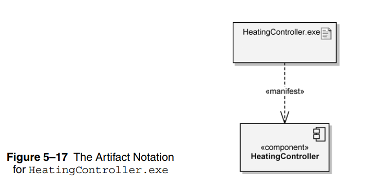
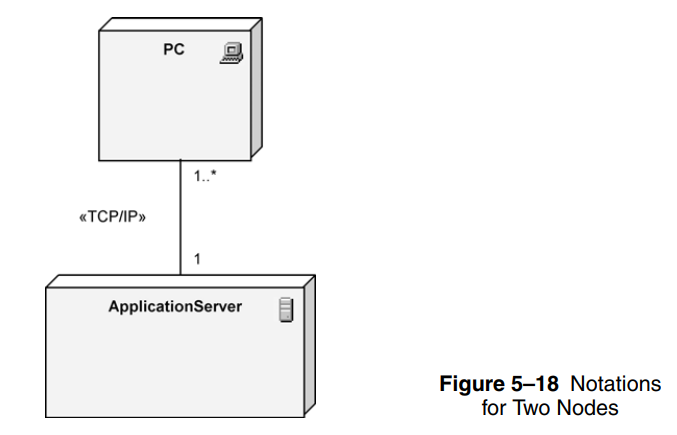
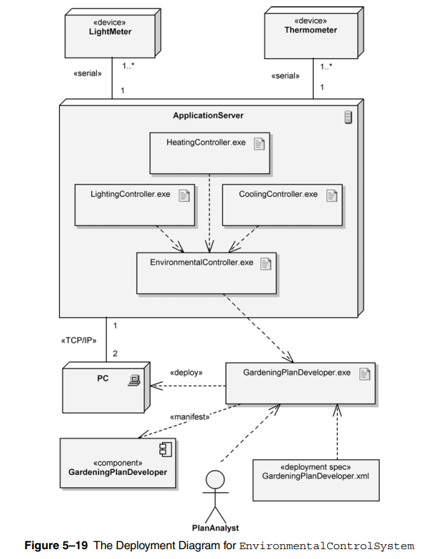

# Deployment Diagram

- used to show the allocation of artifacts to nodes in the physical design of a system

- deployment diagram **essential elements**
  - **artifacts**
  - **nodes**

## Artifacts

> artifact: physical item that implements a portion of sw design (could be an executable of a sw module)

- `<<manifest>>` stereotype means that `HeatingController.exe` is the implementation (executable format) of the `HeatingController` component

## Nodes

> node: like a server. it's a computational resource containing memory and processing on which artifacts are deployed for execution

- types of nodes:
  - devices: PC, sensor
  - execution env.: database, tomcat server

- nodes communicate throw messages/signals throw a communication path indicated by **solid line**

- if the path is uni-directional, it may have an arrow at one of it's ends

- communication path may represent HW coupling (USB, ethernet connection, shared-memory), and also represent more indirect couplings (satellite-to-gound, http, tcp/ip, websockets, gRPC)

---

## Example

