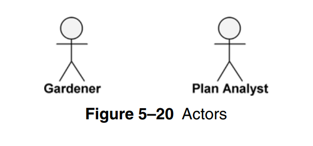
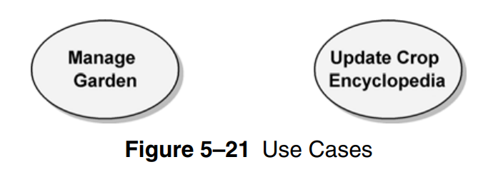
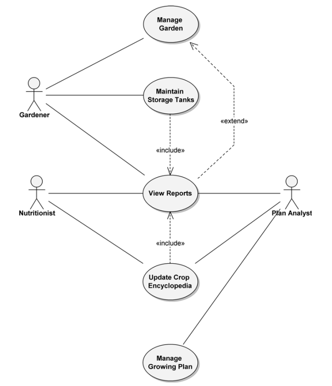
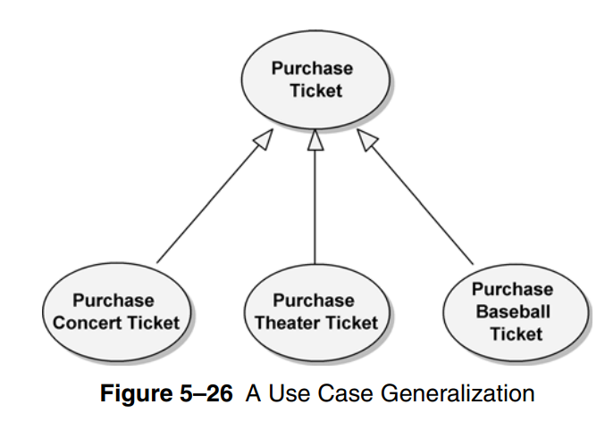

# Use Case Diagram

- used to model the functionality of the system, and the **actors** who interact with it (people / other systems)

- use case diagram **essential elements**
  - **actors**
  - **use-cases**

## Actors

- entities external to the system, interact with or use the system. represented by stick figures with labels beneath them

## Use Cases

- **complete** set of event/transactions that can be performed by an actor. represented by ovals

---

## Use Case Specification

- use-case diagram may have the following elements
  - use-case name
  - purpose
  - optimistic flow
  - pragmatic flows
  - pre-conditions
  - post-conditions
  - limitations
  - assumptions

## Relationships

- `<<include>>`, and `<<extend>>` relations are used to model relationships between use-cases

- include relationship indicates that one use-case includes another (taking decision includes viewing reports)

- extend serves a similar purpose, it indicates that one use-case maybe performed as part of another (but not required)

- generalization is a type of relationship that indicates that one use-case is a generalization of another (share logic with and extend it)

