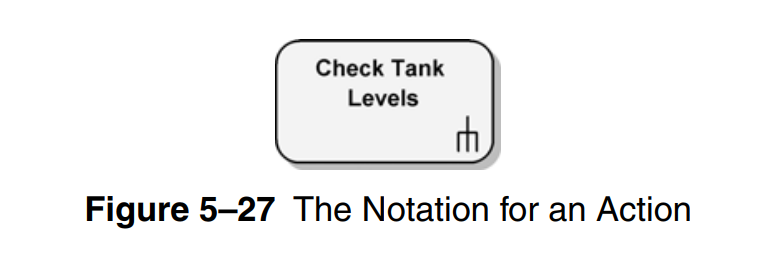
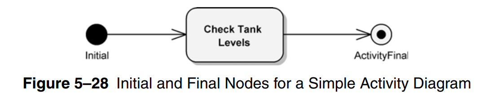
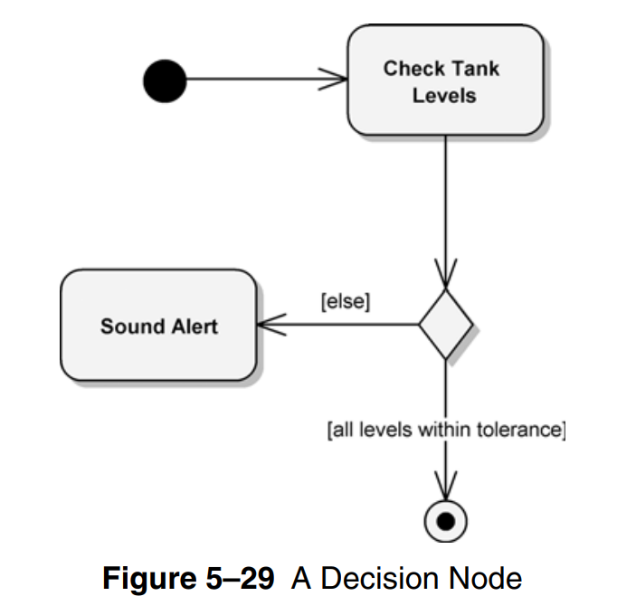
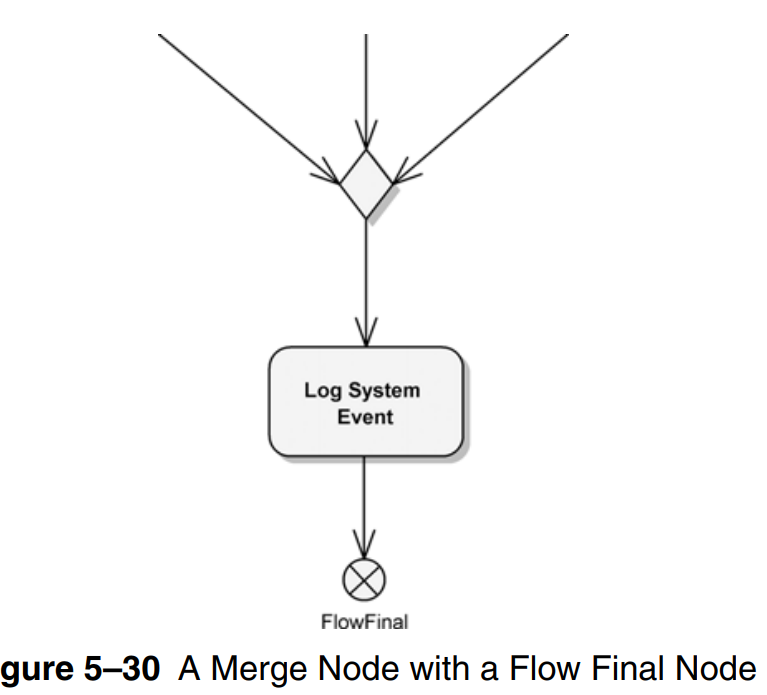
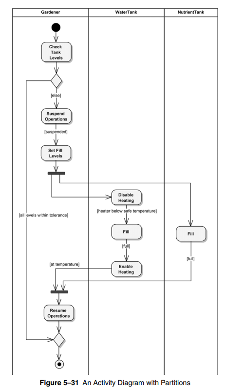
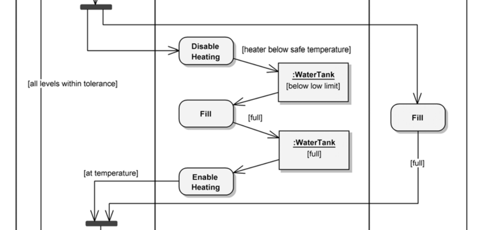

# Activity Diagram

- used to provide visual depictions of the flow of activities, whether in a system, business, workflow, or other process

- These diagrams focus on the activities that are performed and who (or what) is responsible for the performance of
those activities

- activity diagram **essential elements**
  - **action nodes**
  - **control nodes**
  - **object nodes**

## Actions Nodes

- activities can contain many actions which are what activity diagrams depict

- actions maybe grouped into partitions to determine respnosibility (another department, subsystem, ...)

## Control Nodes

- there are 3 types of control nodes:
  - initial & final
  - decision & merge
  - fork & join

### Starting and Stopping

- since this diagram depict flows of action, any flow must have a start and an end

- final nodes are either **activity final** `eye`, or **flow final** `X`

### Decision and Merge

- Decision and merge nodes control the flow in an activity diagram

- Each node is represented by a diamond shape with incoming and outgoing arrows

- `decision node`: one incoming arrow and one/more outgoing arrows
  - redirects the incoming into **one and only one** outgoing flow
  - no waiting or sync. at decision nodes

- `merge node`: one/more incoming arrows and one outgoing arrow
  - redirects all incoming into the outgoing flow
  - no waiting or sync. at merge nodes

### Fork and Join

- similar to decision and merge nodes, but indicates **concurrency**

- in fork, the outbound flow occur concurrently

- in join, all inbound flows must be completed before the outbound flow occurs

## object Nodes

- sometimes, it's useful to see the objects manipulated in such actions, but it's not recommended for all activity diagrams

