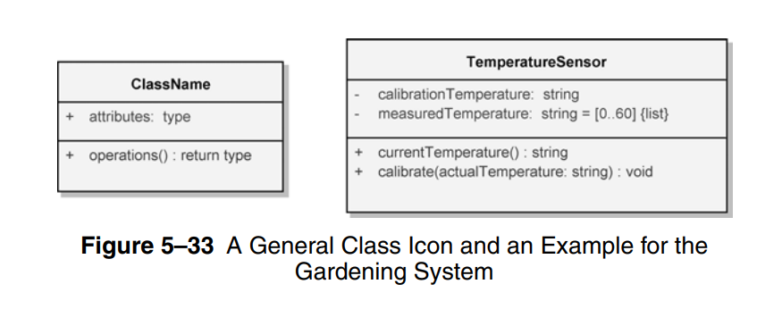
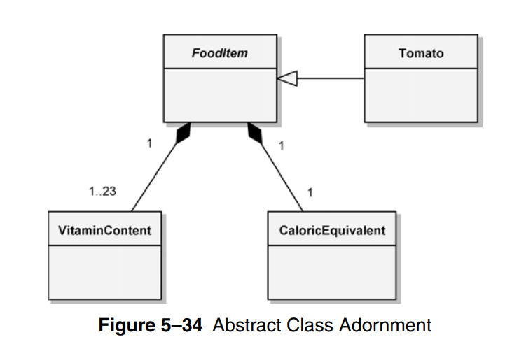
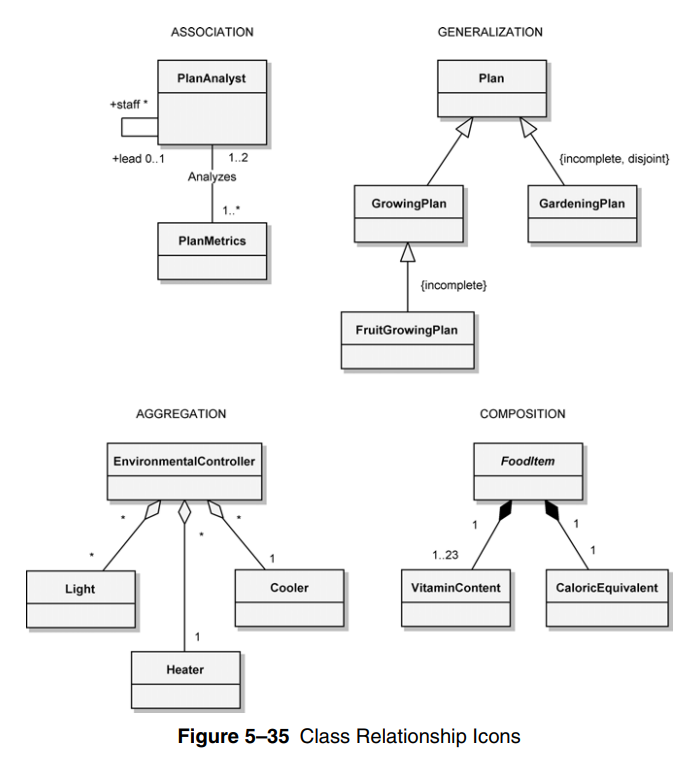
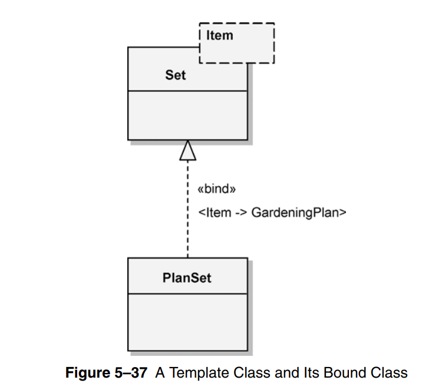

# Class Diagram

- used to show the existence of classes and their relationships in the logical view of a system

- component diagram **essential elements**
  - **classes**
  - **relationships**

## Class

- represent the structure of a class (attributes, methods, and their accessibility)

- property format `visibility attributeName : Type [multiplicity] = DefaultValue {property string}`
  - ex. `- grades: []double = [] {list}`
  - {list} means it's not ordered & non-unique

- method format `visibility methodName (parameter: type) : returnType {method string}`
  - ex. `+ calculateTax(amount: double): double`

- class names are in PascalCase

- if the class name is in _italics_, it means this class is **abstract**

## Relationships

- classes rarely stand-alone, usually they communicate with other classes through **relationships** with **multiplicity**

### Relationship types

- dependency: weakest, mapped to method return type, method parameter, method local temporary object `[Client] ------> [Supplier]`

- association: class uses another to accomplish a task `[Class A] ---------------- [Class B]`
  - written with arrow if not bi-directional

- aggregation: whole-part relationship where the part can exist on it's own `[Whole] <|◇---------------- [Part]`

- composition: whole-part relationship where the whole can exist on it's own `[Whole] <|◆---------------- [Part]`

- inheritance: is-a relationship (parent & child classes) `[Subclass] --------|> [Superclass]`

- realization: class implements an interface `[Class] ------|> [Interface]`

### Extra

- sometimes we need to capture extra information

- here are how to specify a template class `<T>`

### Visibility

- Public `+`: Visible to any element that can see the class

- Protected `#`: Visible to other elements within the class and to subclasses

- Private `-`: Visible to other elements within the class

- Package `~`: Visible to elements within the same package (java related)

---

## Readings

- class diagram constraints
