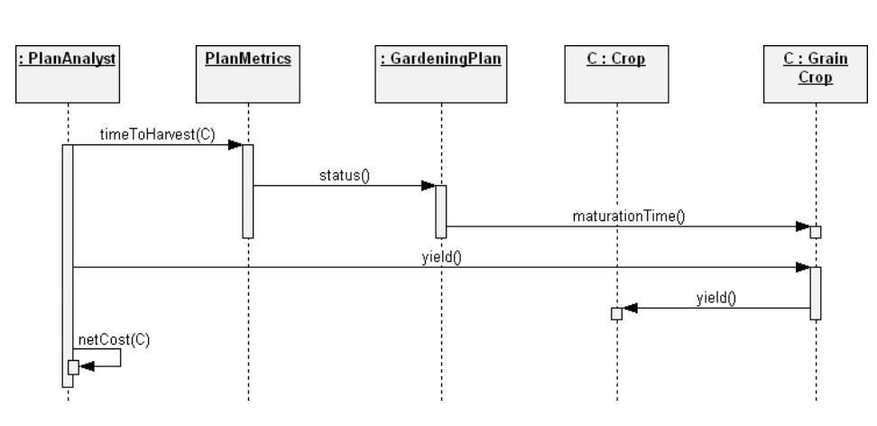
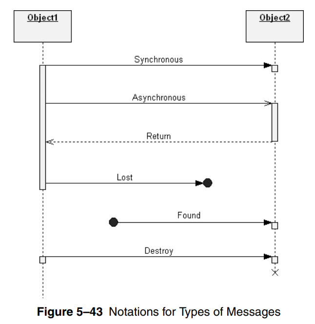
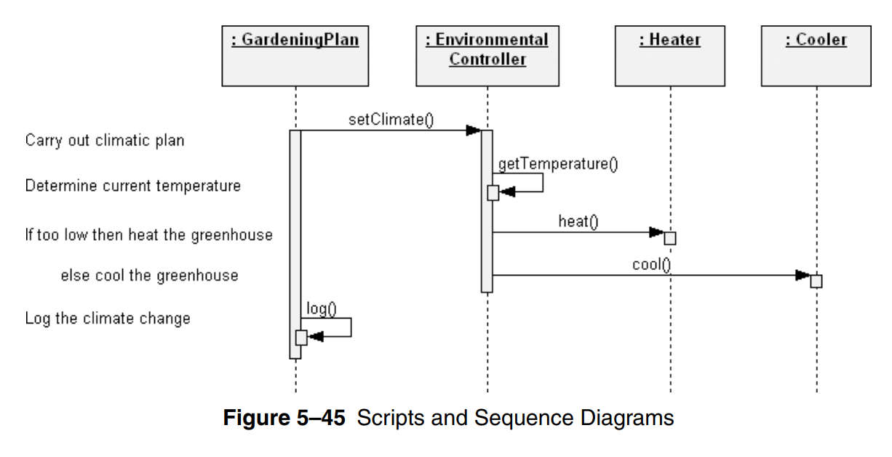
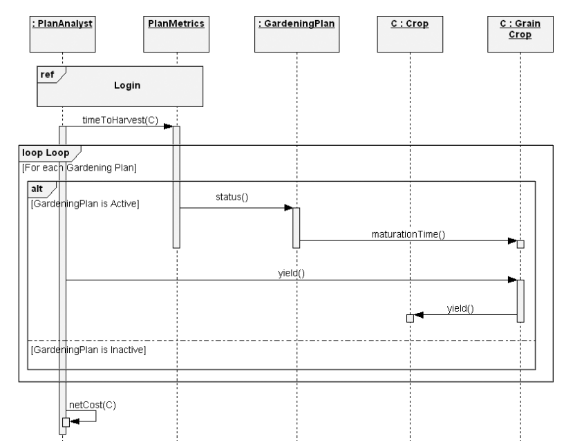

# Sequence Diagram

- used to trace the execution of a scenario

- sequence diagram **essential elements**
  - **objects**
  - **interactions**
  - **life lines**
  - **messages**

- objects represent entities of interest

- entities interact using messages of different types

- sync: like a method call (solid line with **filled** arrow)

- lost message: didn't reach it's destination

- found message: sender is not known

> X at the end of a life line means the object is destroyed

- sometimes clarifying scripts are used (not part of UML)

- in complex sequence diagrams, we can simplify be referring to other sequences using `ref`

- we use `loop` to state that a sequence is repeated multiple times

- along with `alt` to state that a sequence is conditional

- in the following example the loop executes only on active plans using `loop` + `alt`

