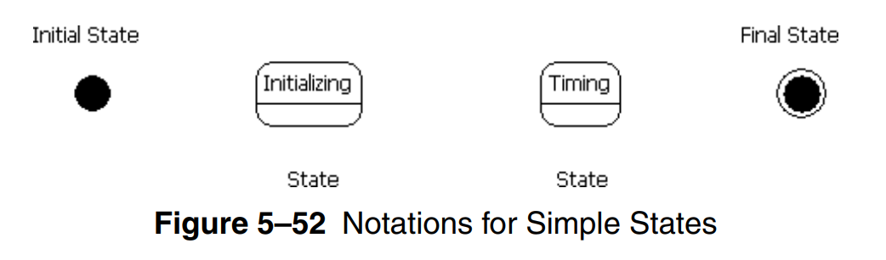
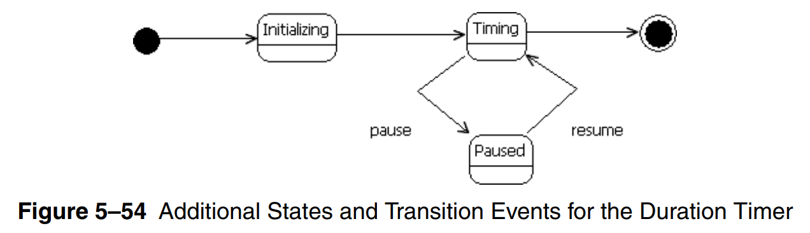
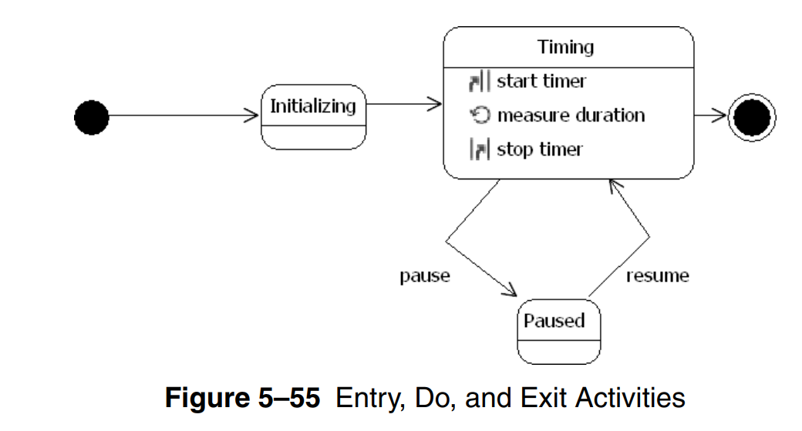
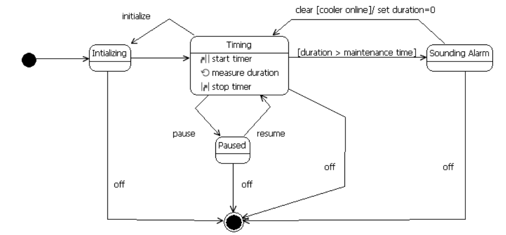
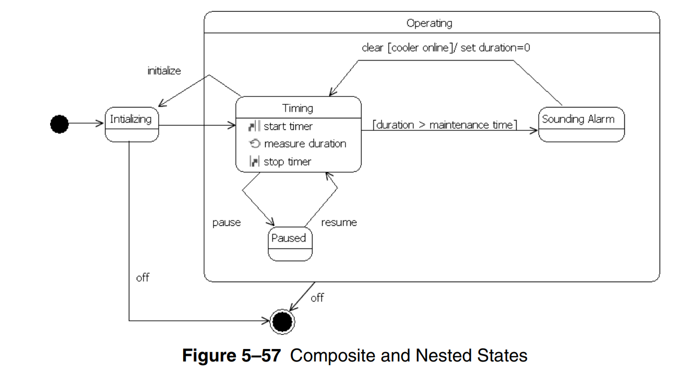
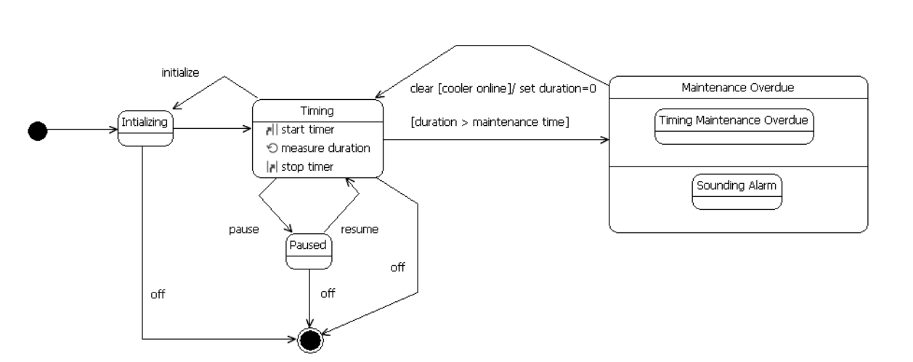

# State Machine Diagram

- used to design and understand time-critical systems, in
which the consequences of improper timing are severe

- used to describe the behavior of individual objects

- not every class has significant event-ordered behavior, so we supply state machine diagrams only for those classes that exhibit such behavior

- state machine diagram **essential elements**
  - **states**
  - **transitions and events**

- state of an object represents the cumulative results of its behavior

## Initial, Final, and Simple State

- when an object is in a given state, it can:
  - execute activity
  - wait for an event
  - fulfill a condition

- initial and final state are called _pseudostates_

## Transitions and Events

- transition: movement between two states

- a state can have a transition to itself

- a transition with no label is called **simple transition**, it means that when the source state completes, the target state starts automatically

- states may change based on events. an **event** is some occurrence that may cause the state of a system to change

- we may need to speicify some activities to be carried out after entering a state, during, or before leaving a state

- another way to control transition behavior is to use effects. An effect is a behavior (e.g., an activity, an action) that occurs when a specified event occurs

- states maybe composed of, or part of another states

- when a state is divided in 2/more regions, this means that each of them is executed concurrently

