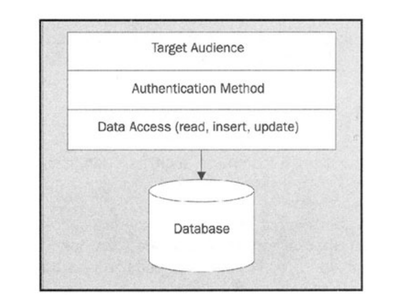

# DB Security

- this chapter examines the techniques and best practices that you as a developer can use to secure your
database and data

## Designing a Security Model

- the following picture shows the general design of a database security model

### Identifying Your Target Audience

- your target audience will affect the various areas of your security modal design such as determining what type of authentication to use as weil as what types of permissions to grant to the various users and groups

- for example, if you're building:
  - e-commerce: most of the access is read-only
  - B2B: you'll need also to update data on a regular basis

- common authentication methods include:
  - OS authentication (OS account)
  - sql server authentication (username + password)

### Identifyig the Type of Data Access Needed

- let's consider an e-commerce application, users will:
  - view products
  - search for product DVDs
  - list the most popular DVD variants
  - see details of specific DVD
  - add to cart / or continue adding more products
  - finally check out

- all the steps before the last 1/2 is a read-only operations

- You have to determine when each is appropriate, design your web pages accordingly and use **two logins** for accessing the database

- 2 logins example:
  - you app connects to DB using 2 different accounts depending on the operation
  - a read catalog, view menu operation will be executed using the **read_only** account
  - while a check-out, order placement operation will be executed using the **read_write** account

- the reason we use this mechanism is **security**

- this way, a SQL injection attack on the read_only account can't modify/delete the data

- also if a bad query is sent using the read_only account, it won't modify the data, and fail fast

> using 2 logins is a best practice

#### Defining Users and Groups

- a user is a single login in the DB, it has it's own permissions

- a group is a collection of users. a group can have permissions which are applied to all users in the group

- a user can have different permissions to access different DBs
  - a developer can modify tables in development DB, but not in production DB

- never use a root (administrative) role by the application (root/postgres user) as if the creds are leaked. a major damage can be done to the DB

- group login is typically associated with a OS domain group.

- using groups provide maintainbility of accounts easily

#### Using Strong Passwords

- a common policy of a password that it contains a:
  - lowercase letter
  - uppercase letter
  - number
  - special character

- it shouldn't represent a word/name/dob/..etc

- the length differs, but usually not less than 7/8 characters

- passwords after than are not stored as plain text. they must be encrypted first

> auditing DB changes is a good idea to invistigate potential security issues

- another way to help keep sensitive information secure is to use Secure Sockets Layer (SSL) on your web site. Using SSL will keep your information secure and encrypted to prevent it from being intercepted and read by unauthorized persons

---

## Readings

- principle of least privilege

- encryption vs. hashing

- SSL (secure socket layer)
